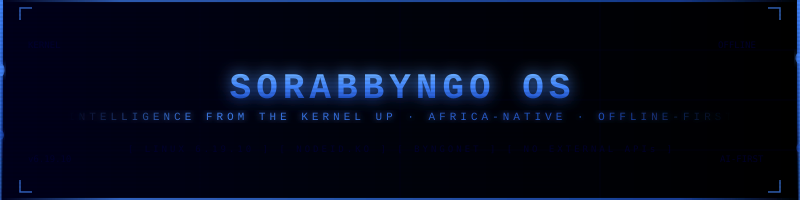
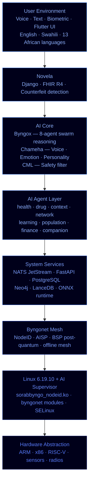
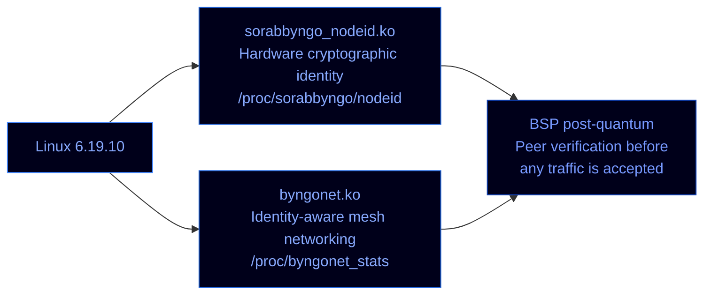

<p align="center">
  
</p>

<p align="center">
  <strong>SORABBYNGO OS — Intelligence from the kernel up</strong><br/>
  Linux 6.19.10 · Offline-first · Africa-native · No external API keys
</p>

<p align="center">
  
  
  
  
  
</p>

---

SORABBYNGO OS is a full AI operating system built from the ground up. Intelligence is not a feature added on top — it is built into every layer, from the hardware identity module to the voice interface. This is not a Linux distro with an AI assistant bolted on. The AI **is** the OS.

---

## System architecture



---

## OS surfaces

All surfaces share the Sorabbyngo AI Kernel as their root base.

| Surface | Repo | Target | Key requirement | Status |
|---|---|---|---|---|
| Sorabbyngo OS | `sorabbyngo-os` | Base / development | Current build target | 🔧 In development |
| Novela OS | `novela-os` | Medical / clinical | PREEMPT_RT real-time | 🔜 Planned |
| Byngo OS | `byngo-os` | Consumer devices | Android compatibility | 🔜 Planned |
| Edge OS | `edge-os` | IoT / drones / vehicles | Minimal footprint | 🔜 Planned |
| Sentinel OS | `sentinel-os` | Cybersecurity ops | Hardened kernel | 🔜 Planned |
| Server OS | `server-os` | Infrastructure | High throughput | 🔜 Planned |

---

## Model stack

| Tier | Models | Runtime | Condition |
|---|---|---|---|
| Tier 1 | Phi-4 Mini · SmolLM2 360M · meditron:7b · Aya 23 8B | Ollama | Always-on, no internet, 4–8GB RAM |
| Tier 2 | Phi-4 14B · Gemma 3 4B · Qwen 2.5 7B · Aya 23 35B | Ollama | GPU devices, 24GB+ VRAM |
| Tier 3 | Qwen 2.5 72B · Mistral Small 3.1 | Ollama | Performance devices |
| Tier 4 | DeepSeek-R1 70B · Mixtral 8x22B · LLaMA 3.1 70B | Byngox Prime vLLM | Self-hosted H100/A100 cluster |
| Medical | GatorTron · Meditron-70B · BioMistral · ClinicalT5 | ONNX + HuggingFace | Clinical intelligence |
| Embeddings | nomic-embed-text · mxbai-embed-large | Ollama | Vector memory |

> No external API keys. No data leaves Sorabbyngo infrastructure.

---

## Custom kernel modules



---

## Build phases

| Phase | Description | Status |
|---|---|---|
| 1 | Custom kernel — Linux 6.19.10 | ✅ Complete |
| 2 | Root filesystem — Buildroot | 🔜 Next |
| 3 | Init system — systemd | 🔜 Planned |
| 4 | AI runtime layer | 🔜 Planned |
| 5 | ISO / image builder | 🔜 Planned |
| 6 | Installer | 🔜 Planned |

---

## Build instructions

```bash
cp /boot/config-$(uname -r) .config
make olddefconfig LOCALVERSION=""
./scripts/kconfig/merge_config.sh .config sorabbyngo.config
make -j$(nproc) LOCALVERSION=""
sudo make modules_install LOCALVERSION=""
sudo cp arch/x86/boot/bzImage /boot/vmlinuz-6.19.10-sorabbyngo
sudo update-initramfs -c -k 6.19.10-sorabbyngo
sudo update-grub
```

---

## Repository structure
sorabbyngo-os/
├── board/              # Hardware board configs
│   └── sorabbyngo/     # Target board definitions
├── configs/            # Per-surface kernel defconfigs
│   ├── sorabbyngo_defconfig
│   ├── sorabbyngo_medical_defconfig
│   ├── sorabbyngo_sentinel_defconfig
│   ├── sorabbyngo_server_defconfig
│   ├── sorabbyngo_edge_arm_defconfig
│   └── sorabbyngo_consumer_defconfig
├── drivers/            # Custom kernel modules
│   ├── sorabbyngo_nodeid.ko
│   └── byngonet/
├── patches/            # Kernel patch set
└── sorabbyngo.config   # AI supervisor config fragment
---

## Related repositories

| Repo | Role |
|---|---|
| `sorabbyngo-patches` | Kernel patch set |
| `sorabbyngo-build` | Build system, ADRs, roadmap |
| `byngox` | AI reasoning engine |
| `chameha` | Voice and personality interface |
| `byngonet` | Mesh network protocol |
| `novela` | Health platform |
| `security` | 7-ring defence architecture |

---

<p align="center">
  <strong>Sorabbyngo Company</strong> · Kisii, Kenya · 2026<br/>
  <em>Rhythm of Digital Life</em>
</p>
